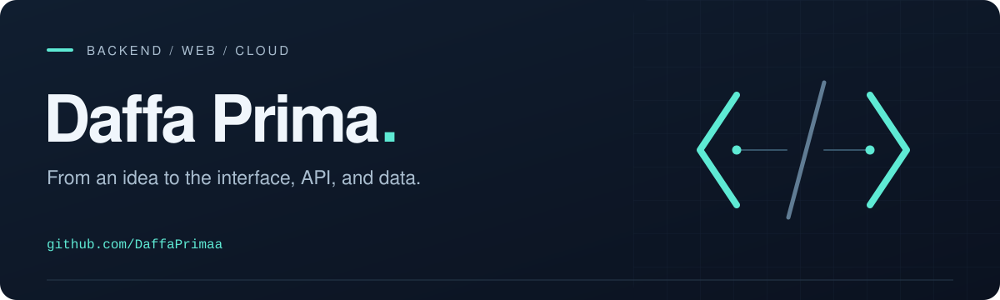

  

  <a href="#selected-work">Selected work</a> &nbsp; / &nbsp;
  <a href="#toolbox">Toolbox</a> &nbsp; / &nbsp;
  <a href="#contribution-trail">Activity</a> &nbsp; / &nbsp;
  <a href="https://www.linkedin.com/in/daffaprimaputra/">LinkedIn ↗</a>

 

### A little about me

I'm **Daffa Prima**. I build web applications and explore **backend development** and **cloud computing**.

My projects span a clinic information system, business websites, and responsive web interfaces. I enjoy connecting the pieces: the interface people use, the API behind it, and the data that makes it work.

- **Building with** Python, FastAPI, React, and JavaScript.
- **Interested in** API design, backend systems, and cloud infrastructure.
- **Learning by** turning practical problems into working projects.

### Selected work

| Project | What it's about | Built with |
| :--- | :--- | :--- |
| **[Art & Cosmetic Dental](https://github.com/DaffaPrimaa/Art-and-Cosmetic-Dental-)** | A clinic information system with separate frontend and backend applications. | Python · FastAPI · React · SQLite |
| **[ACDC Clinic Website](https://github.com/DaffaPrimaa/Website-Profil-ACDC)** | A clinic profile website presenting services, opening hours, and contact information. | HTML · CSS · JavaScript |
| **[Grafologi — Hero Redesign](https://github.com/DaffaPrimaa/hero-redesign-grafologi)** | A responsive redesign of a course landing page's hero section, built without a framework. | HTML · CSS · JavaScript |

[Explore all repositories →](https://github.com/DaffaPrimaa?tab=repositories)

### Toolbox

**Backend & data** &nbsp; `Python` `FastAPI` `SQLite` 
**Frontend** &nbsp; `JavaScript` `React` `Tailwind CSS` `HTML` `CSS` 
**Currently exploring** &nbsp; Cloud computing & backend architecture

### Contribution trail

A small, playful view of my GitHub contributions. Updated every 12 hours.

<picture>
  <source media="(prefers-color-scheme: dark)" srcset="https://raw.githubusercontent.com/DaffaPrimaa/daffaprimaa/output/snake-dark.svg" />
  <source media="(prefers-color-scheme: light)" srcset="https://raw.githubusercontent.com/DaffaPrimaa/daffaprimaa/output/snake.svg" />
  
</picture>

---

**Let's connect.** Find me on [LinkedIn](https://www.linkedin.com/in/daffaprimaputra/) or browse what I'm building [here on GitHub](https://github.com/DaffaPrimaa?tab=repositories).
